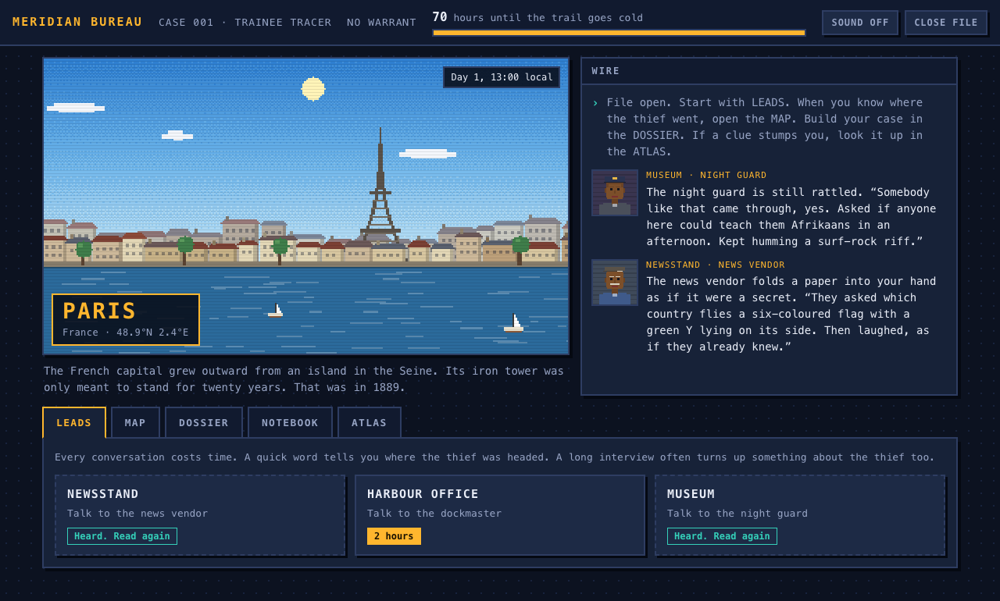

# Meridian Bureau: The Magpie Ring Files

An original globe-trotting detective game for the browser. Something precious has been stolen, a
black-and-white feather was left at the scene, and you have a limited number of hours to follow
the thief from city to city, work out who they are, and make the arrest.

**Play it in your browser: <https://skalamera.github.io/carmen-san-diego/>**



## How to play

1. **Leads.** Question witnesses in the city you are in. Every conversation costs time: a quick
   word (1 hour) tells you where the thief was headed, and a long interview (3 hours) usually
   turns up something about the thief as well.
2. **Map.** Witnesses describe the next city by its currency, flag, language or landmarks. Pick
   it from the departures board and fly. A wrong turn costs hours, and nobody there will have
   seen anything.
3. **Dossier.** Enter what you have learned about the thief (scarf, getaway, companion, snack,
   the tune they hum). When exactly one member of the Magpie Ring fits, request a warrant.
4. **Atlas.** Stuck on a clue? Every city's currency, language, flag and claims to fame are in
   the atlas.
5. Catch up with the thief, warrant in hand, before the trail goes cold. No warrant, or the
   wrong name on it, and they walk.

Solved cases earn promotions, from Trainee Tracer to Chief Inspector. Each rank means a longer
trail (4 to 8 cities) and less time to spare. There are ten Ring members to put behind bars.
Progress is saved in your browser.

## Run it

The link above is the quickest way to play. To run your own copy there is nothing to build or
install. Open `index.html` in a browser, or serve the folder:

```bash
python3 -m http.server 4173
```

Then visit <http://localhost:4173>.

## What is in here

| File | What it does |
| --- | --- |
| `index.html`, `css/style.css` | The page and its look |
| `js/data.js` | 32 cities, 10 suspects, witness lines, ranks |
| `js/engine.js` | Case generator and rules (no DOM, so it can be tested on its own) |
| `js/art.js` | Pixel painter: city scenes that follow the local time of day, faces, world map |
| `js/audio.js` | Synthesised sound effects |
| `js/ui.js` | Screens and input |

Every picture and sound is generated in code. There are no image, font or audio files, and no
dependencies.

## About

This is an original game. Its title, characters, organisations, writing, art and sound were made
for this project, and it is not affiliated with any other game or franchise. The characters and
stolen objects are fictional. The geography is real.
